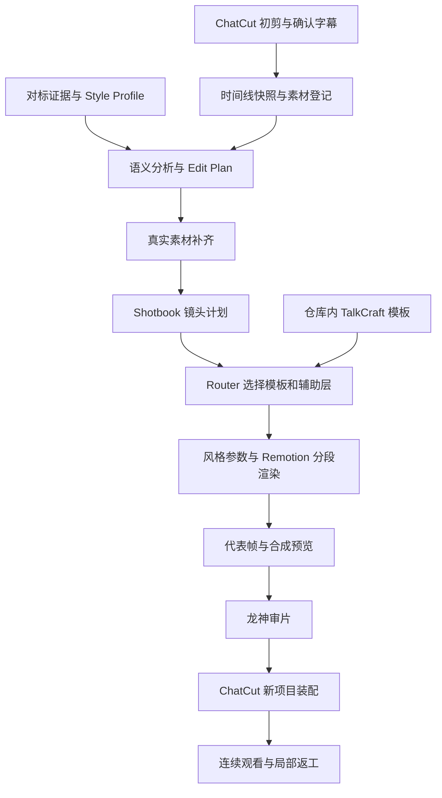

# jianjipro × Video TalkCraft 整合 Spec v0.1

日期：2026-10-01

状态：设计草稿，供龙神审阅；尚未实施接入。

首版目标：用同一条真实口播验证“jianjipro 的风格规划 + TalkCraft 的动效实现 + ChatCut 的装配”是否值得采用。

## 1. 结论

在 jianjipro 内增加一个 TalkCraft 模板执行来源。保留 jianjipro 的对标证据、风格规则、语义规划和选卡约束；引入经过挑选的 TalkCraft 模板、渲染工具和必要质检工具。ChatCut 继续负责初剪、字幕、时间线装配和人工调整。

独立安装的 Video TalkCraft 保留原状。整合版的模板、修改和试剪工程放在 jianjipro 内，效果不满意时可继续使用独立 TalkCraft。

首版交付可比较的真实样片，以及可重复执行的模板选择、渲染和装配流程。“视觉更满意”由龙神观看后判断。

## 2. 已确认的需求与当前事实

### 用户需求

- 输入是实拍口播；初剪在 ChatCut 内完成，不用 Whisper。
- 拍摄时有价值的临时补充保留，以实际说话和确认字幕为准。
- 包装需要多种效果、图标、真实截图和适合的全屏 B-roll。
- 采用 jianjipro 中已拆解的对标风格，利用 TalkCraft 更丰富的动效模板。
- 复杂包装可按透明视频分段交付；文字、颜色和动画参数在源工程修改后重渲染。
- 最终在 ChatCut 内查看和调整；不使用 Workbench。
- 先给预览，由龙神审片，再决定继续修改或接受。

### 本次核对的项目事实

| 项目 | 当前状况 | 对接意义 |
|---|---|---|
| jianjipro | 已有语义、风格、Shotbook、Router 规则与卡片库；路线图中自动 Shotbook、Router 实际脚本和 ChatCut mapping 尚未完成 | 接入要补实际执行链，复制模板不足以实现自动调用 |
| TalkCraft | 已安装配方文档、TSX 模板、HTML demo、索引脚本和渲染/质检工具；技能列出 108 张卡 | 作为实现资源，逐张核验实际输入和参数 |
| 风格档 | `ai-talkinghead-editorial-v0.1` 为候选，样本创作者标记为 mixed-or-unverified | 应用可追溯规则，不宣称已经精准复刻某一位博主 |
| 真实试剪 | 之前已完成单片适配和 ChatCut 装配 | 可作为对照，不等同于仓库自动集成已完成 |
| Remotion | jianjipro 库配置为 4.0.522；TalkCraft runtime 为 4.0.519 | 首版独立运行环境，避免混用依赖 |

## 3. 方案比较

| 方案 | 收益 | 代价 | 本次选择 |
|---|---|---|---|
| 精选模板复制到 jianjipro，增加适配与执行入口 | 便于修改、追溯和对比，不依赖全局技能路径 | 需要维护版本记录和适配层 | **采用** |
| jianjipro 直接调用全局 TalkCraft 安装目录 | 接入快 | 全局升级会影响结果，项目依赖安装位置 | 不作为长期接入方式 |
| 整体迁移 TalkCraft 流程并替换 jianjipro | 模板覆盖面大 | 默认音频处理、风格、审片和交付流程与现有需求不同，验证范围过大 | 本轮不采用 |

## 4. 工作流程与职责



| 环节 | 负责工具 | 核心产物 |
|---|---|---|
| 初剪、字幕 | ChatCut | 已确认切点、字幕及源片映射 |
| 风格与语义 | jianjipro 现有规范，Codex 按规范执行 | semantic map、edit plan、风格规则引用 |
| 素材 | Codex 搜集，项目素材清单登记 | Logo、截图、图标、B-roll 及来源 |
| 镜头规划 | jianjipro Shotbook | 人物模式、安全区、信息关系与输入 |
| 模板选择 | 新增 Router 脚本；Codex 提供经过核验的输入 | 候选、淘汰理由、resolved shotbook |
| 动效制作 | 仓库内 TalkCraft 模板 + Remotion | 分段透明 MOV、全屏片段和预览 |
| 装配与修改 | ChatCut 工具接口 | 新试剪项目和装配审计 |
| 主观验收 | 龙神 | 满意、修改或退回独立 TalkCraft |

首版不宣称全链一键自动化：语义理解、素材选择与镜头计划先由 Codex 按现有协议完成；确定性脚本负责校验、选卡、渲染和装配数据。

## 5. 首批引入内容

### 5.1 第一批：此前真实视频已经使用的八类模板

“此前使用”指单片工程曾适配使用，复制原版后仍需验证，不自动标记为可直接投入生产。

| 模板 | 用途 | 接入层 |
|---|---|---|
| split-text-stagger | 短句分组、重音入场 | Primary：强调/观点，按内容核验 |
| title-demote-to-label | 标题出现后缩为角标 | Primary：章节；标签在本镜内延续 |
| keyword-pop-highlight | 核心词强调 | Primary：强调，或独立辅助强调；同镜不重复计为两种主卡 |
| numbered-step-stack | 明确先后步骤 | Primary：process；不能用于普通并列 |
| word-slot-cycle | 同一语义槽位替换词 | Primary：强调；不能替代多维比较 |
| parallel-items-with-host | 人物在场的并列排版 | Primary：list；具体版式须核验人物素材条件 |
| quote-hold-arrow | 引用或观点配指向 | Primary：quote/statement，按实际内容核验；外部引用须有来源 |
| slow-push-in | 轻微镜头推近 | Camera 辅助层，不能作为主卡解决信息结构 |

### 5.2 第二批：补充真正不同的画面形态

在第一批能渲染后，核验并接入 `media-pop-in`、`split-60-40-story`、`evidence-scroll-tour`、`split-compare-slider`。分别服务素材入场、人物与素材分屏、长截图讲解、媒体前后对比。

第二批仍属于首版范围，但只有通过输入、参数和稳定帧验证的卡进入可选集合。`split-compare-slider` 不用于纯观点或数字对比；缺适配卡的语义返回升级/生成请求，不能借模板名称强行命中。

全屏 B-roll 使用独立媒体镜头，不为了覆盖口播而强制套动效卡。先接入这两批资源；其余模板暂不复制生产源码。后续根据真实镜头缺口补充。

### 5.3 同步带入的依赖与工具

- 所选卡对应的配方 MD、TSX、离线 demo 和实际引用的公共文件。
- 需要的主题框架、动画辅助函数；按文件依赖核对，不复制整个目录作为默认依赖。
- 卡片索引与 demo 验证工具；分段渲染、代表帧、透明通道和运动检查所需工具。
- 所复制文件的来源、快照版本、SHA-256、上游许可和第三方声明。
- 既有自动检查按用途适配。Workbench 合同检查不进入本流程；静止检查允许有意停留的截图与干净口播，不机械判为失败。

## 6. 计划修改的仓库位置

以下都是拟新增或拟修改的路径，本次仅创建此 spec。

```text
motion-library/
  vendor/talkcraft/            # 所选上游原始文件、许可与快照清单
  adapters/talkcraft/          # 参数、输入、时间与能力映射
  runtime-talkcraft/           # 独立 package.json / lockfile / 渲染入口
  taxonomy/talkcraft-capabilities.yaml
  scripts/                    # 增加索引、解析、计划检查等入口
styles/ai-talkinghead-editorial-v0.1/
  talkcraft-theme.yaml         # 本风格的颜色、字体、布局与动效约束
references/style-engine/
  shotbook.schema.yaml         # 扩展 resolution、时间锚点、交付字段
skills/style-engine/
  motion-router/SKILL.md       # 支持新增来源，保持现有决策顺序
  shotbook-planner/SKILL.md     # 明确分层、清爽口播与素材切换
  visual-qc/SKILL.md            # 渲染与实际 ChatCut 合成验收
  talkcraft-executor/SKILL.md   # 适配后的制作入口
scripts/chatcut/               # 时间线快照、装配计划、对账
projects/<project-id>/         # 项目计划、参数、素材、渲染与验收报告
docs/style-engine-v2/          # 更新职责、运行方式和真实完成状态
```

原始上游文件保留在 vendor；项目修改由 adapter、主题参数或项目内派生卡实现。现有卡片库继续保留，不把 TalkCraft TSX 硬写成旧卡的 Component/manifest 格式。

运行环境采用独立 lockfile，初始固定此前试剪的 Remotion 4.0.519，所有 `@remotion/*` 包同版本。只安装所需依赖，不提交 node_modules，不链接到全局 TalkCraft runtime。已有 4.0.522 库继续按原配置运行。正式合并运行环境需另做兼容性验证。

## 7. 核心接口约束

### 7.1 从“导演意图”到模板

1. Planner 输出语义关系、family/subtype、输入要求和视觉目的，不输出模板 ID。
2. Adapter 将 TalkCraft 的输入、语义和真实 props 映射到既有 taxonomy。映射逐卡核验，不只凭标题和 frontmatter 推断。
3. Router 沿用 Input → Family → Subtype → Capability，并记录布局、重复惩罚及选择理由。
4. 来源使用 `provider: talkcraft`，卡 ID 使用 `talkcraft:<slug>`。现有卡 ID 保留；辅助层拥有自己的来源与参数。
5. 缺真实素材、必须人物抠像却没有透明人物、固定项数不符等情况直接淘汰。允许的参数升级须先验证。

同一结构连续使用超过现有 Router 允许次数时，必须换合适布局、返回清爽口播，或明确提出缺卡；不能换个颜色就算不同效果。

### 7.2 Shotbook 扩展

保留现有字段，新增向后兼容字段：

| 字段 | 含义 |
|---|---|
| `timebase` | fps、时间线版本；保存原始微秒时间，渲染使用帧网格 |
| `timing_precision` | sentence / word / manual；句级字幕不能冒充字级对齐 |
| `style_rule_ids` | 本镜采用的风格规则及 reference event 来源 |
| `resolution.provider` | legacy / talkcraft / generated；仅在执行解析后填写 |
| `resolution.primary_card` | 沿用已有 schema 的主卡字段；统一 Router 文档里 card_id 的称呼 |
| `resolution.upstream_revision` | 卡片快照版本或内容哈希 |
| `resolution.props / media_bindings` | 真正生效的参数和素材引用 |
| `render_contract` | 分辨率、帧数、透明要求、人物是否已包含、音频策略 |
| `deliverables` | 分段输出路径、起止帧、素材时长和导入方式 |

原始时间与渲染帧分别保存，不逐镜累计四舍五入。初剪变化后，依赖其时间映射的计划和输出失效，重新计算受影响片段。

无需包装的镜头沿用 `primary_card: null`，标记 `status: clean_presenter`，在计划校验中作为合法结果。

### 7.3 风格与模板之间的关系

视觉主题由 jianjipro 风格档控制，TalkCraft 提供运动结构。统一处理字体、字号、颜色、底板、圆角、阴影和字幕安全区，不能逐镜随手改色。

模板没有暴露的参数，由 adapter 或项目派生卡增加真实接口后再使用；不能只在 JSON 写参数却让画面继续用硬编码。保留模板关键时序和层级，换肤后检查布局与可读性。

对标规则决定何时加强包装、何时回到人物。连接句、解释、安抚和收束允许干净口播，不继承“每句都必须有运动”的默认要求。

## 8. 素材与 ChatCut 交付

### 素材处理

- 工具首次出现：优先官方 Logo、实际产品截图；图标表达抽象动作时可使用有来源的矢量素材。
- 演示产品效果、案例或结果：必须用对应真实截图/录屏；普通互联网 B-roll 只用于氛围或动作示意。
- 每项素材记录来源页面、获取时间、用途、文件哈希和已知授权状态；不能把“可下载”当成已授权。
- 真实素材缺失时输出缺口，先给计划或清爽口播预览，不伪造产品界面。

### 分段交付

- 人物旁包装：静音 ProRes 4444 透明 MOV，保留底层人物口播。
- 全屏素材：独立 B-roll/截图轨道；装饰层可另交透明 MOV。
- 包含人物的复杂版式：明确标记人物已渲染，避免叠加双重人物。其音频仍由原口播主线承担。
- 字幕尽量保持 ChatCut 原生字幕，不重复烧进包装层。包装中的标题/标签由源工程修改后重渲染。
- SFX 独立音频片段，允许在 ChatCut 调整音量和位置。
- 同时保留源码、镜头参数和渲染清单；文字、颜色、节奏修改只重新渲染受影响片段。

ChatCut 内可调整分段位置、裁切、显隐、素材和音量。透明 MOV 内的文字与动画不是原生可编辑元素，这一限制需要交付时说明。

### 装配可靠性

每次试剪建立新的项目副本。执行前核对时间线快照版本，执行后对账主线与字幕；导入记录保存资产 ID、轨道 ID 和镜头 ID。同一计划重复执行不应重复添加轨道或片段。

素材绑定和导入失败时保留旧可用版本，标记失败镜头，不留下“看起来完成”的半装配项目。B-roll 裁切与人物安全区以 ChatCut 实际合成帧验收；此前遇到的 contain/cover 几何差异纳入检查。

## 9. 首次验证：沿用这条真实口播

输入素材：`/Users/jupiwulong/Downloads/5998c256415d453a8ac1d0781f1e11af.MOV`。

对照资料：`jianying-headless/work/real-talkcraft-20260930/` 中的初剪映射、确认字幕、SHOTBOOK-v2 和交付记录。执行前重新读取 ChatCut 项目；若后来已有用户修改，以当前确认时间线为准，先更新基线快照。

此前基线为 35 个主线片段、53 条字幕、30 fps 共 3410 帧。该数字用于对账，不作为对当前项目未读取状态的承诺。

先制作三个代表段，覆盖：

1. 首次工具实体出现：Logo/关键词，人物安全区清晰。
2. 列举或步骤：按真实信息关系选择不同结构，展示适当变化。
3. 全屏真实截图或 B-roll：素材主导后返回干净口播。

若文案中有明确比较，再制作比较镜头；没有该语义则用独立演示验证比较卡，不为展示模板改写口播。

样段预览确认后，再扩展整片。在新 ChatCut 项目与此前 TalkCraft v2 对照，不覆盖原项目。

## 10. 阶段交付和验收

| 阶段 | 交付 | 通过条件 |
|---|---|---|
| A：接入资源 | 两批候选卡、来源清单、独立运行环境、能力索引 | 参数与必需输入核对完成；可用卡 demo/代表帧通过；未通过卡标记不可选 |
| B：贯通接口 | Router 脚本、resolved shotbook、装配计划 | 能解释选卡与淘汰原因；错误输入被拒绝；辅助层不冒充 Primary |
| C：样段对比 | 三类代表段的合成预览及计划 | 龙神确认风格、节奏和效果方向，或明确修改 |
| D：整片试剪 | 新 ChatCut 项目、分段素材、源码和报告 | 主线/字幕对账通过，实际合成无明显遮挡、露底、断帧；完成连续观看与试听 |

机器验收重点：精确帧长、透明通道、时间映射、输入素材、主线/字幕保留、重复导入、实际几何。动画检查关注可读停留与有效运动，不以运动越多越好。

人工验收重点：重点是否清楚、节奏是否顺、样式是否贴合对标、效果是否变化合理、B-roll 是否相关、音效是否干扰。截图检查通过不等于连续播放和试听通过；最终导出前仍需龙神确认。

## 11. 返工与成本控制

- 镜头缓存键包含模板/adapter 版本、props、主题、素材哈希、时长、fps、分辨率和运行环境版本。
- 改一个镜头只渲该镜头；改全片主题才使全部相关镜头失效。
- 样段先确认，减少整片返工；不重复转录已经确认的字幕。
- 先使用现有卡；缺卡时明确返回升级/生成请求。首版不顺带实现完整通用生成器。
- 龙神可逐步看到“现在用什么工具、做什么、产出什么”；流程不因接口自动化而隐藏中间决策。

## 12. 保留、退出与来源约束

整合项目与独立 TalkCraft 项目分别保留。若对比效果不满意，可停用 jianjipro 的 TalkCraft 执行来源，继续使用独立技能；已保存的主线、字幕、素材和试剪记录可复用。

上游安装目录的 `LICENSE` 标明 PolyForm Noncommercial，并要求保留作者声明，商业使用要求作者授权。复制代码时将许可和所涉第三方声明随文件保存；本 spec 不能视为取得商业授权。首版范围为本地整合测试。

## 13. 本轮边界与下一步

本轮不做：ChatCut 原生复杂动效组件转换、剪映交付、Workbench、重新 ASR/TTS、整体替换已有卡片库、自动抓取全部模板、完整素材管理网站。

本次实际改动只有这份 spec。龙神审阅后，根据反馈修订；确认设计后再形成可执行实施计划，从资源接入与代表样段开始推进。

### 设计依据

- `AGENTS.md`、`docs/style-engine-v2/execution-boundary.md`、`roadmap.md`。
- `references/style-engine/shotbook.schema.yaml`。
- `motion-library/taxonomy/families.yaml`、`router-policy.yaml`、`card-capabilities.schema.yaml`。
- `skills/style-engine/motion-router/SKILL.md`。
- 已安装 TalkCraft 的 `SKILL.md`、卡片配方、runtime 配置、`LICENSE` 和 `THIRD_PARTY_NOTICES.md`。
- 此前真实视频工程与本次对话确认的用户偏好。
