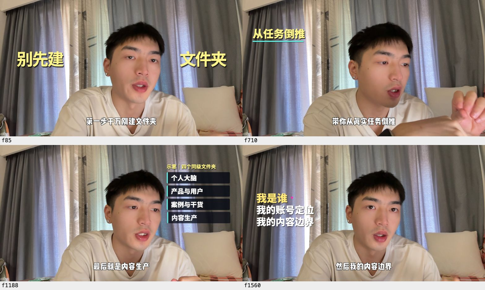

# 前 59.567 秒稳定帧检查（测试版）

## 当前实装

- ChatCut Desktop：`Capitalist Blush Octopus`。
- 当前时间线：`jianjipro-前60秒包装测试版`，1787 帧、30fps、1920×1080。
- V1：14 段原人物口播；V2：4 段包装；字幕：31 张，`white-impact`。
- 原完整时间线与同长度纯口播底片均保留。

## 稳定帧

按时间线帧 85、710、1188、1560 抽样。四处文字均可读；人物眼口和字幕没有被包装遮挡。四文件夹画面明确写有“示意”，四项为同级。第一版开场入场曾挡眼，已把入场改为淡入并复查 70、72、75、80、110、115 帧；没有再观察到挡眼。其余入场按逐词时间查询后复查。

## 尚未完成的检查

- 没有连续播放或逐秒听审；不能据稳定帧断言口播衔接、音效和整个运动过程都合格。
- 没有导出视频；此页不是最终成片验收。
- 本次无真实 Obsidian 录屏，文字示意只能验证信息结构，不能验证实际软件演示的可读性。
- 字幕自动转录已检查整段 31 张文本并修正 `Obsidian` 大小写；口播原音仍需用户试听确认。
